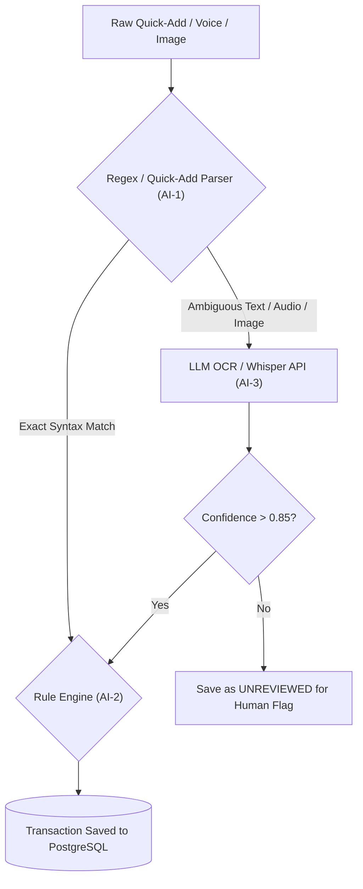

# 🗄️🤖 Database & AI Phased Execution Roadmap

This document outlines the end-to-end technical execution roadmap for the **Database (DB-x)** and **AI & Natural Language Engine (AI-x)** modules of the Expense Manager application.

---

## 🗄️ Part 1: Database Execution Roadmap (`DB-x`)

| Phase ID | Phase Name | Technical Scope & Key Deliverables | Target Artifacts | Status |
| :--- | :--- | :--- | :--- | :--- |
| **DB-1** | **Logical 3NF Schema & Domain Design** | • Define 10 entities (`Account`, `Category`, `Tag`, `Transaction`, `Attachment`, `Subscription`, `WishlistItem`, `Budget`, `Rule`, `ApiKey`)<br>• Normalized to 3NF with explicit cardinalities<br>• Decoupled heavy OCR text/blobs from main feed | Domain Blueprint | ✅ **Completed** |
| **DB-2** | **Physical Schema & Environment Initialization** | • Environment variable baseline (`DATABASE_URL`, API secrets)<br>• Singleton Prisma client configuration<br>• Initial Prisma schema & generator compilation | `.env`<br>`package.json`<br>`prisma/schema.prisma`<br>`src/lib/prisma.ts` | ✅ **Completed** |
| **DB-3** | **Composite Indexing & FK Cascade Rules** | • Composite indexes for high-speed feeds & budget queries (`[date(sort: Desc)]`, `[categoryId, date]`, `[fromAccountId, date]`, `[status]`)<br>• Foreign key deletion policies (`Restrict` for Accounts, `SetNull` for Categories, `Cascade` for Attachments/Budgets) | `prisma/schema.prisma` | ✅ **Completed** |
| **DB-4** | **Database Seeding & Default Master Data** | • Seed standard asset/liability accounts (Checking, Cash, Credit Card)<br>• Seed spending/income categories with Lucide icon codes & colors<br>• Seed baseline auto-categorization rules (e.g., "uber", "starbucks") | `prisma/seed.ts` | 🎯 **Pending** |
| **DB-5** | **Data Integrity & Audit Strategy** | • Status transition validation (`UNREVIEWED` ➔ `CONFIRMED` ➔ `FLAGGED`)<br>• Audit fields (`createdAt`, `updatedAt`) and soft-delete/archive hooks | Migration SQL & Hooks | 🎯 **Pending** |

---

## 🤖 Part 2: AI Engine Execution Roadmap (`AI-x`)

Follows a **deterministic-first, confidence-gated approach** — non-AI parsers handle exact rules first; AI models handle unstructured edge cases with explicit confidence thresholds.



| Phase ID | Phase Name | Technical Scope & Key Deliverables | Core Logic & Architecture | Status |
| :--- | :--- | :--- | :--- | :--- |
| **AI-1** | **Notion Quick-Add & Life-Hours Parser** | • Deterministic regex syntax parser for input strings:<br>`<Category/Description> <Amount> [from <Account>] [to <TargetAccount>] [on <Date>] [#tag] [#mood]`<br>• Relative date solver ("yesterday", "last Friday")<br>• **Life-Hours Cost Engine**: `Labor Hours = Transaction Amount / Hourly Wage W` | `src/lib/parser/quickAdd.ts`<br>`src/lib/parser/lifeHours.ts` | 🎯 **Next Phase** |
| **AI-2** | **Rules-Based Auto-Categorizer** | • Fast keyword and regex pattern matching against `Rule` table<br>• Confidence scoring (1.0 for exact rule hit, 0.7 for partial match)<br>• Assigns `categoryId` and `intent` (`NEED`, `WANT`, `INVESTMENT`) | `src/lib/categorizer/rulesEngine.ts` | 🎯 **Pending** |
| **AI-3** | **LLM Unstructured Text & Voice OCR Pipeline** | • Integration with Gemini API / OpenAI Whisper for receipt image scanning and audio transcript parsing<br>• **Structured JSON Output**: Forced JSON schema response<br>• **Confidence Gate**: Below 0.85 confidence sets status to `UNREVIEWED` | `src/app/api/v1/parse/route.ts`<br>`src/lib/ai/geminiScanner.ts` | 🎯 **Pending** |
| **AI-4** | **Model Context Protocol (MCP) Server Route** | • Native MCP endpoint at `/api/v1/mcp`<br>• Tool definitions for external AI assistants (Cursor, Claude, Antigravity):<br>  - `get_monthly_budget_status(month)`<br>  - `log_expense(quick_add_text)`<br>  - `search_transactions(query, category, startDate, endDate)`<br>  - `get_spending_insights(period)` | `src/app/api/v1/mcp/route.ts` | 🎯 **Pending** |

---

## 🔗 Cross-Phase Dependency Matrix

```
[DB-1: 3NF Schema] ──► [DB-2: Prisma Init] ──► [DB-3: Indexing] ──► [DB-4: Seed Script]
                                                                        │
                                                                        ▼
[AI-1: Quick-Add Parser] ──► [AI-2: Rules Engine] ──► [AI-3: OCR/Voice] ──► [AI-4: MCP Server Route]
```
